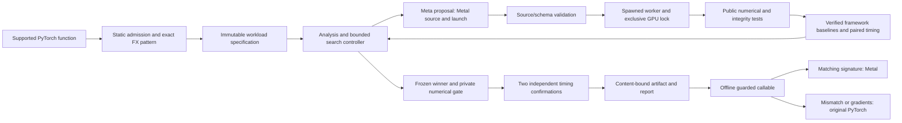

# Runtime architecture

MetalMind is a local Python controller with a hosted Meta generation provider
and an Apple Silicon GPU evaluator. The supported unit is one pure forward
function with a frozen tensor signature. The first release does not rewrite
arbitrary models.

The model supplies Metal source and launch dimensions, never host Python. The
trusted host owns compilation, input construction, output allocation, baseline
selection, timing, correctness policies, and fallback. Compiler failures and
numerical/timing rejections are feedback; private final fixtures are withheld
from search. Search cannot continue after consuming the final gate.

Workers enforce one absolute deadline, memory preflight, and a global GPU lock.
Crashes, device failures, and timeouts latch a fault and stop subsequent work.
A known-good `doctor --smoke` probe must pass before clearing it. These measures
contain ordinary failures; they do not securely isolate malicious GPU source.

The controller reserves request and token capacity durably before dispatch.
Interrupted reservations stay charged. Resume checks frozen identities and the
original wall deadline. Terminal/finalizing runs do not resume paid search.

Promotion requires all 22 private fixtures and both confirmation sessions to
pass every required available baseline: median public-call gain at least 1.05×
and paired-bootstrap lower 95% bound above 1.00×. Reports retain raw pairs,
ordering, baseline identities, domain mode, and failures. Unstable timing is a
rejection, never an inferred speedup.

Artifacts bind source, launch, workload, guards, ABI, numerical/timing evidence,
and environment. Hardware identity includes GPU model and core configuration.
Loading checks content integrity, reference identity, and environment before
compiling. The resulting wrapper guards shapes, strides, dtype, device, aliasing,
and gradients. Checked mode additionally verifies the numerical input domain;
assumed mode requires an explicit caller guarantee and separate labeling.
