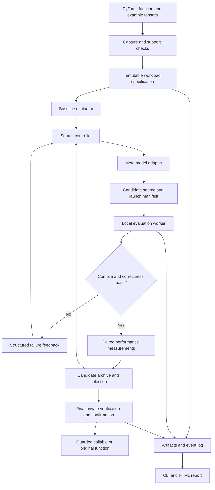

# MetalMind: End-to-End System Design

**Prepared:** October 29, 2026  
**Status:** Proposed technical design; implementation has not started.  
**Project:** An autonomous Meta-model-powered optimizer for PyTorch workloads on Apple Silicon GPUs.  
**Implementation checklist:** [MetalMind implementation plan](../plans/2026-10-29-metalmind.md)

## 1. What we are building

MetalMind takes a supported PyTorch function, describes its tensor computation, measures its existing performance on an Apple GPU, and asks a Meta model to propose a Metal implementation. A local evaluator compiles that implementation, checks its numerical behavior, measures it against existing implementations, and returns structured feedback. The agent uses that feedback to improve the next candidate. The result is a reusable, guarded function plus the evidence behind the optimization decision.

The developer should not have to understand Metal threadgroups, GPU reductions, or launch tuning to use the system. They should be able to inspect those details when they want to understand a result.

**Product promise:** “Give MetalMind a supported PyTorch function. It searches for a faster Apple GPU implementation, verifies candidates automatically, and keeps PyTorch when it cannot establish a reliable win.”

The hackathon demonstration is a visible instance of this complete system, rather than a separate throwaway application. Its essential story is input → measurement → model proposal → compilation → correctness → feedback → improvement → reusable output.

## 2. Decisions already made and planning assumptions

### Confirmed by the user

- One person is building the project.
- There is enough time to complete the project; there is no imposed weekend or 48-hour schedule.
- The first release is a **function-level optimizer**. Broader graph analysis and region replacement follow later.
- The optimizer targets Apple Silicon GPUs through Metal and accepts PyTorch workloads.
- Meta models drive generation and iterative optimization.
- Numerical checking and measured performance improvement are central to the project.
- The hackathon positioning is **Push the Frontier**.

### Proposed engineering choices

These are recommendations, not user-confirmed requirements:

| Decision | Proposed default | Reason |
|---|---|---|
| Main implementation | Python 3.12 | Fits PyTorch, testing, model clients, and a small solo-maintained codebase |
| Execution backend | PyTorch MPS tensors and `torch.mps.compile_shader` | Keeps the primary interface in PyTorch and avoids an initial native tensor bridge |
| Initial package | `metalmind` | One installable package with a CLI and Python API |
| Agent control | Explicit Python state machine | Makes budgets, failures, promotion, and replay easy to test |
| Initial scope | Pure forward functions returning one tensor | Avoids hidden state, aliasing, and gradient semantics in the first release |
| Numerical coverage | FP32 first; FP16 is a separate milestone | Makes failure diagnosis manageable without removing the eventual dtype roadmap |
| Artifact storage | Versioned directories, JSON manifests, JSONL events | Inspectable, portable, and sufficient for a single-machine application |
| Presentation | CLI and generated HTML report first | The optimization engine remains useful independently of a dashboard |
| Search execution | One local GPU evaluation at a time | Prevents competing candidates from contaminating timing |
| Deployment | Local package and documented environment | Apple GPU execution stays on the Mac; a web deployment is unnecessary |

The exact chip, memory, macOS version, model entitlement, and hackathon rules are **environment facts to record at the first milestone**, not reasons to delay planning or ask for a deadline. The plan adapts to the available machine through capability checks and conservative workload sizes.

## 3. Research findings that change the architecture

### 3.1 A direct PyTorch-to-Metal route exists

PyTorch documents `torch.mps.compile_shader(source)` for runtime compilation and invocation of Metal kernels from Python. This is the preferred foundation. The project's first technical milestone must verify dispatch configuration, scalar arguments, output buffers, error reporting, and timing on the actual installed version. [PyTorch compile_shader documentation](https://docs.pytorch.org/docs/2.14/generated/torch.mps.compile_shader.html)

Upstream tests exercise explicit `threads` and `group_size` launch arguments and a kernel's `max_threads_per_threadgroup`. Keep these details behind one adapter and test them against the chosen wheel; they should not spread through the agent. [PyTorch MPS tests, v2.14.0](https://github.com/pytorch/pytorch/blob/v2.14.0/test/test_mps.py)

### 3.2 The framework baseline is moving quickly

PyTorch 2.14 introduced additional native Metal implementations and reduction improvements. PyTorch 2.15 was announced on October 28, 2026 and changes MPS platform requirements. A result against an old eager baseline is insufficient evidence of an advantage over current tooling. Proposed environment: test 2.15 on macOS 15 or newer, retain 2.14 as a compatibility fallback, and pin the version that passes the capability suite. Do not upgrade midway through an experiment series. [PyTorch 2.14 announcement](https://pytorch.org/blog/pytorch-2-14-release-blog/), [PyTorch 2.15 announcement](https://pytorch.org/blog/pytorch-2-15-release-blog/)

Whether `torch.compile` is useful for each selected workload is an empirical capability check. Do not assume that MPS compilation is either universally supported or universally unavailable. Record the backend and configuration, and verify that the supposedly compiled callable executes the intended workload correctly.

### 3.3 “Latest Meta model” needs a dated configuration

As checked on October 29, 2026, Meta documents `muse-wonder-1.0` for complex coding and agentic work and `muse-spark-1.3` as a current Spark model. Proposed main search model: Wonder; proposed lower-cost comparison or access fallback: Spark 1.3. Wonder Full is a different access offering and is not an interchangeable Model API ID. Keep provider, endpoint, model ID, reasoning settings, and returned model metadata in every run. If hackathon rules require Llama specifically, choose an eligible Llama endpoint during setup and retain the same optimizer architecture. [Meta model catalog](https://dev.meta.ai/docs/models)

Meta's documented API base URL is `https://api.meta.ai/v1`; its quickstart demonstrates use through the OpenAI Python SDK. That SDK is a client transport here: inference remains with the selected Meta model. Validate the needed request and output format with a real small request before relying on structured output or tool-call compatibility. [Meta API quickstart](https://dev.meta.ai/docs/quickstart)

### 3.4 Existing Metal optimization projects affect the pitch

KernelBench provides a useful precedent for evaluating generated kernels. MetalBench already describes a closed-loop Metal agent, and Metal-Sci studies iterative Metal search with held-out evaluation. MetalMind must not claim to be the first autonomous Metal optimizer. Its proposed contribution is a focused PyTorch-facing workflow, explicit reuse guards, Meta-model-driven search, rigorous failure handling, and reproducible evidence. These are goals to demonstrate, not proof that every individual mechanism is novel. [KernelBench](https://github.com/ScalingIntelligence/KernelBench), [MetalBench](https://github.com/Lazarus-931/MetalBench), [Metal-Sci paper](https://arxiv.org/abs/2605.09708)

### 3.5 Hardware tuning must be capability-aware

Apple documents thread execution width and the maximum threads allowed by a particular compute pipeline. Those limits can depend on the pipeline, not just the chip's name. Validate candidate launches against actual exposed limits; do not hard-code a universal SIMD width or assume every Mac has the same capabilities. [Apple thread execution width](https://developer.apple.com/documentation/metal/mtlcomputepipelinestate/threadexecutionwidth), [Apple grid and threadgroup sizing](https://developer.apple.com/documentation/metal/calculating-threadgroup-and-grid-sizes)

## 4. Approaches considered

| Approach | What it builds | Advantage | Cost or limitation | Decision |
|---|---|---|---|---|
| Function-level optimizer with direct Metal execution | Replaces one explicitly selected, supported function | Smallest complete optimization loop; clear correctness and performance boundaries | Does not discover and replace arbitrary model regions | **Selected by the user** |
| Graph capture plus automatic region replacement | Finds supported subgraphs in a larger model and substitutes kernels | Closer to the long-term “analyze my model” experience | Adds tracing, partitioning, graph guards, aliasing, and integration failure modes | Follow-on after function-level release |
| General compiler backend | Broad automatic lowering for PyTorch graphs | Broadest potential impact | Requires substantial compiler infrastructure and semantic coverage | Research direction, outside the initial release |

Backend alternatives within the selected approach:

- **Direct PyTorch shader compilation:** preferred after capability checks.
- **MLX custom Metal kernels:** useful for an optional independent comparison or a clearly labeled alternative backend. It changes framework interoperability and synchronization responsibilities, so it is not a silent replacement for the PyTorch execution path. [MLX custom Metal kernels](https://ml-explore.github.io/mlx/build/html/dev/custom_metal_kernels.html)
- **A narrow native Objective-C++ bridge:** fallback only if the direct shader interface cannot provide a required execution contract. It must use supported PyTorch MPS integration, correct streams, and explicit lifetime handling. Avoid reconstructing a Metal buffer from a raw tensor pointer.

Choose one backend for the first release. Multiple backends are not a prerequisite for a compelling project.

## 5. Scope, support contract, and release boundaries

### 5.1 Core release

The complete function-level release includes:

1. Environment and model-access diagnostics.
2. A workload specification with exact mathematics and input restrictions.
3. Capture or description of supported PyTorch operations.
4. Baseline measurements and a bottleneck hypothesis.
5. Meta-model-generated Metal source and declarative launch metadata.
6. Compilation, numerical verification, and benchmark feedback.
7. Bounded autonomous iteration and a best-candidate archive.
8. Final independent verification and performance confirmation.
9. A reusable optimized callable with deterministic fallback.
10. Reproducible reports, raw measurements, and a demonstrable user flow.

### 5.2 Initial function support

- Pure, deterministic forward functions.
- One tensor output, freshly allocated; input tensors remain unchanged.
- FP32 tensors initially.
- MPS device; dense contiguous inputs with zero storage offset.
- Exact shapes and exact strides for each optimized signature.
- Tensor parameters remain runtime inputs; their contents must not be frozen into a kernel.
- Python scalar parameters become declared specialization constants and are part of the cache key.
- No input aliasing, mutation, randomness, stateful modules, or data-dependent Python control flow.
- No autograd support in generated kernels. Calls made with gradient recording enabled and a gradient-requiring input use the original function.
- Supported value domain is declared. Version one targets finite, ordinary-range floating-point inputs; nonfinite equivalence is not promised.

The public first-release function interface accepts **trusted, importable top-level Python functions**. A function must resolve by `module:qualname`, have no closure or mutable captures, and match the fingerprint captured by the controller. Immutable scalar defaults and scalar globals are allowed only when captured in the semantic specification and checked again by the worker. Tensor-valued globals, lambdas, local functions, arbitrary callable instances, and bound stateful modules are unsupported initially, even if some are traceable by FX. Their original callable remains available for fallback.

An optimized signature is narrower than a family of functions. A kernel validated for `(256, 1024), float32` has no authority to run for `(256, 1025)` without its own validated contract.

The first internal demonstration may use registered workload fixtures. The public function-level release adds a restricted `torch.fx` capture path that recognizes the same supported expressions. Unsupported functions return an explanation and retain the original callable; the model does not decide whether an arbitrary function is semantically supported. FX is used here to describe a selected function, not to rewrite an entire model. [PyTorch FX documentation](https://docs.pytorch.org/docs/2.15/fx.html)

### 5.3 Deliberate exclusions from the first release

General matrix multiplication optimization, convolution libraries, attention kernels, backward generation, arbitrary broadcasting, sparse or quantized tensors, complex values, multi-device execution, arbitrary model rewriting, and automatic production deployment. These remain separate future milestones.

Matrix multiplication can appear as an unchanged operation in an integration example. Beating Apple's existing dense matrix multiplication is not a required early success criterion.

### 5.4 Failure conditions even if the demo looks impressive

- A speedup that comes from omitting synchronization or comparing different semantics.
- A kernel that works only for the exact tensor values used during search.
- Hidden changes to tolerances, dtype, or baseline configuration.
- A report that excludes unsuccessful jobs from its denominator.
- A faster kernel whose public wrapper makes the actual function slower.
- A canned sequence presented as a fresh autonomous search.
- A function advertised as supporting training when it only supports inference.

## 6. Workloads and mathematical contracts

Start with one easy fused workload, then add two reduction families. The following are proposed initial fixtures; freeze their definitions before performance search.

### 6.1 Bias plus tanh-approximate GELU

Inputs: `x[B, D]` and `bias[D]`. Output: `y[B, D]` with the same dtype as `x`.

Mathematics: let `z = x + bias`; compute `0.5 * z * (1 + tanh(sqrt(2/pi) * (z + 0.044715 * z^3)))`.

The PyTorch function must explicitly request the tanh approximation. Exact GELU using `erf` is a different contract. Start with FP32, where fusion can remove intermediate reads, writes, and launches. For the FP16 extension, cast both input tensors to FP32 before the addition, perform the complete expression in FP32, and cast only the final output to FP16. An FP16 expression that rounds the addition first is a different contract.

Search dimensions: elements per thread, scalar versus vectorized loads, threadgroup size, tail handling, and expression scheduling. Performance hypotheses must be checked, because the current framework may already do some of this efficiently.

### 6.2 RMS normalization

Inputs: `x[B, D]`, `weight[D]`, and fixed scalar `eps = 1e-5`.

Mathematics: `y[b,d] = x[b,d] * rsqrt(mean_d(x[b,d]^2) + eps) * weight[d]`.

For the FP16 extension, cast `x` and `weight` to FP32, perform the square, mean, reciprocal square root, and final multiplication in FP32, then cast the output to FP16. The reference function must make these casts explicit. Epsilon is inside the reciprocal square root and is part of the signature. There is no mean subtraction.

Search dimensions: one row per threadgroup, elements per lane, SIMD reductions, shared partial reductions, and threadgroup size. All participating threads must encounter reduction barriers uniformly, including on partial rows or inactive lanes.

### 6.3 Stable row-wise softmax

Input: `x[B, D]`; normalization axis is the final dimension.

Mathematics: subtract each row maximum, exponentiate shifted values, sum them, and divide by that sum. Use FP32 intermediates for the FP16 extension and cast the final output back.

Search dimensions: row mapping, reduction layout, threadgroup size, and keeping intermediate values in registers versus recomputing. Do not drop maximum subtraction to obtain a speedup. Masked softmax and causal attention are separate contracts.

### 6.4 Proposed benchmark matrix

| Family | Small or irregular case | Medium case | Larger case |
|---|---|---|---|
| Bias + GELU | `x=(64,257)`, `bias=(257,)` | `x=(256,1024)`, `bias=(1024,)` | `x=(512,4096)`, `bias=(4096,)` |
| RMSNorm | `x=(64,257)`, `weight=(257,)` | `x=(256,1024)`, `weight=(1024,)` | `x=(512,4096)`, `weight=(4096,)` |
| Softmax | `x=(64,257)` | `x=(256,1024)` | `x=(128,4096)` |

Core evaluation: **nine FP32 jobs**, each a separate signature. FP16 expands this to eighteen jobs after its own correctness milestone. Keep irregular dimensions in the suite; perfect powers of two conceal tail bugs.

For development, use the small and medium cases. Reserve the larger workload cases for a frozen evaluation campaign. The agent may see an evaluation job's target shape when optimizing that signature; it never sees the final verifier's private values or answers. This tests search on fresh jobs, not zero-shot shape generalization of a fixed-shape kernel.

Tiny sizes, empty inputs, noncontiguous views, nonzero storage offsets, CPU tensors, alternate dtypes, and gradient-requiring calls are guard/fallback tests even when they are outside the optimized performance matrix.

### 6.5 Concrete supported value domains

| Contract | Input bounds, inclusive | Tensor parameter bounds, inclusive |
|---|---|---|
| Bias + GELU | `-10 <= x <= 10` | `-10 <= bias <= 10` |
| RMSNorm | `-100 <= x <= 100` | `-10 <= weight <= 10` |
| Softmax | `-80 <= x <= 80` | No tensor parameter |

All inputs must be finite. Zero is allowed; nonzero subnormal input values are excluded initially, meaning every nonzero input magnitude is at least `torch.finfo(input_dtype).tiny`. These restrictions apply to each input and parameter element, and to both declared dtypes. Output underflow to zero is allowed under the numerical policy. Epsilon is exactly `1e-5` for RMSNorm; row widths and batch sizes are the separately guarded positive dimensions.

These are intentionally bounded initial contracts, not a claim that values outside these ranges cannot be optimized. Public and private fixtures exercise both signs, exact bounds, zeros, small normal values, and independently changing parameters. Widening a domain changes the semantics/policy version and requires fresh verification.

## 7. Developer workflow

### 7.1 First-use experience

1. Install the package in a clean Apple Silicon Python environment.
2. Run `metalmind doctor`; it prints capabilities and actionable missing requirements.
3. Configure a Meta endpoint and key through environment variables or a local ignored configuration file.
4. Select a bundled workload or pass a trusted Python function and representative input tensors.
5. Inspect the captured computation, support decision, and baseline summary.
6. Start optimization with a bounded search configuration.
7. Observe compile errors, correctness failures, verified candidates, and timing changes.
8. Inspect the final report, load the selected artifact, and call it through a PyTorch-compatible wrapper.

### 7.2 Proposed Python interface

These are future interfaces, not code that exists today:

```python
analysis = metalmind.analyze(fn, example_inputs)
result = metalmind.optimize(analysis.workload, config=run_config)
optimized_fn = result.build_callable(fallback=fn)
y = optimized_fn(*new_inputs)
```

`analyze` returns a structured unsupported result when it cannot construct a trustworthy workload specification. `optimize` returns a completed result even when no kernel wins; that result explains the outcome and builds a fallback-only callable.

### 7.3 Proposed command surface

```text
metalmind doctor
metalmind analyze --workload bias_gelu --case medium
metalmind optimize --workload bias_gelu --case medium --config configs/default.yaml
metalmind report --run runs/<run-id>
metalmind verify --artifact artifacts/<artifact-id>
metalmind revalidate --artifact artifacts/<artifact-id> --function examples.my_workloads:bias_gelu
metalmind evaluate --suite configs/evaluation.yaml
```

User function loading is an explicit trusted local operation such as `--function examples.my_workloads:bias_gelu`. MetalMind does not import a module named by the model.

### 7.4 Outputs

Every completed job produces a machine-readable summary, a readable report, the candidate lineage, and raw measurements. A winning job also produces source and a reuse manifest. A no-win job still produces useful analysis and an intact original callable.

## 8. Architecture and ownership



### 8.1 Capture and workload specification

The workload specification is the source of truth. It contains a normalized expression, exact input tensor metadata, scalar parameters, output metadata, dtype and accumulation policy, value-domain declaration, and a versioned correctness policy. The model may propose a different implementation of that specification; it cannot edit the specification.

Support recognition is deterministic. Start with registered fixture specifications, then add whitelisted FX patterns for the three families. Reject trace ambiguity, unsupported operations, mutation, or data-dependent control flow with a clear explanation.

### 8.2 Analyzer

Collect function-level latency, supported operation sequence, tensor sizes, estimated intermediate traffic, and any available trace information. Rank candidate workloads by their measured share of a supplied workflow and plausible removable overhead. For a single selected function, explain its likely bottleneck.

Separate measurements from hypotheses. A CPU profiler's operator duration is not automatically GPU execution time; launch counts inferred from an expression are estimates unless a GPU trace confirms them. Detailed Metal captures are optional diagnostic evidence, outside timing runs.

### 8.3 Model adapter

Responsibilities: authentication, prompt construction, transport, response normalization, retry handling, usage accounting, and returning a validated candidate object. It does not compile source or select winners.

Begin with the direct Meta API. Support one documented API surface in the first implementation. Hide SDK-specific request and response shapes behind the adapter so an eligible provider-hosted Meta endpoint can be added without changing the evaluator.

### 8.4 Search controller

The controller owns state transitions, budgets, candidate selection, feedback summaries, promotion proposals, stopping, and resume behavior. Use one model actor initially; planner, generator, and critic are prompt roles, not a requirement for multiple concurrent agents.

The controller is the agent's durable memory. It keeps the best few verified candidates and concise failure summaries rather than repeatedly sending an unbounded transcript.

### 8.5 Evaluation worker

A fresh spawned worker handles each candidate evaluation. It creates deterministic fixtures locally, compiles source, invokes kernels through the backend adapter, checks output and input integrity, benchmarks against baselines, and returns structured results. GPU timing occurs entirely inside the worker after setup.

Do not pickle live MPS tensors or opaque callable closures between processes. Pass a workload ID, approved reference identifier, metadata, fixture descriptors, and source. For bundled jobs, the worker resolves the registered reference. For the public user-function path, it imports the actual function explicitly selected by the developer, checks its module/source digest, scalar captures/defaults, and normalized semantic hash, then uses that callable as the behavioral reference and original eager baseline. A changed fingerprint fails the job before timing. The normalized computation describes the candidate contract; it must not be substituted for the original function while reporting original-function latency.

The model client lives in the controller; the evaluation worker has no API key and needs no network access. Worker execution is a fault-containment measure, not a guarantee that arbitrary GPU programs are securely sandboxed.

### 8.6 Artifact store and report builder

The store writes immutable candidate source snapshots, manifests, raw numerical results, timing samples, and controller events. The report is derived from these artifacts. A dashboard must not become a second independent source of truth.

## 9. Core data contracts

All serialized contracts carry `schema_version = 1`; loading unsupported future versions fails explicitly.

| Contract | Essential fields | Owner |
|---|---|---|
| `EnvironmentInfo` | OS, architecture, chip/device description if available, memory budget, Python/PyTorch versions, backend capabilities, relevant environment flags | Runtime diagnostics |
| `TensorSpec` | shape, dtype, device type, strides, storage offset, layout | Capture |
| `WorkloadSpec` | ID, semantics version, expression, input/output specs, constants, value domain, reference ID, correctness policy, signature hash | Workload layer |
| `AnalysisResult` | supported flag, reason, optional workload, graph summary, baseline summary, bottleneck hypotheses | Analyzer |
| `CandidateSpec` | ID, parent ID, workload hash, source, entry point, launch metadata, optimization hypothesis, model provenance | Model adapter/controller |
| `EvaluationRequest` | candidate, workload, mode, fixture-plan handle, timing config, environment fingerprint | Controller |
| `EvaluationResult` | compile/runtime status, numerical summary, integrity results, timings, errors, resource observations | Worker |
| `RunConfig` | model settings, budgets, fixture policy, timing policy, output directory, search seed | User/controller |
| `OptimizationResult` | outcome, winner or null, baseline identity, report paths, reason, search statistics | Controller |
| `ArtifactManifest` | source hashes, guards, backend/environment fingerprint, validation evidence hashes, baseline identity, confirmation result | Exporter |

### 9.1 Candidate format

The model returns exactly one JSON object containing:

```json
{
  "schema_version": 1,
  "entry_point": "metalmind_kernel",
  "source": "<Metal source>",
  "threads": [262144, 1, 1],
  "group_size": [256, 1, 1],
  "hypothesis": "<short testable explanation>"
}
```

The launch dimensions above illustrate the format; they are not a universal launch recipe. The host assigns candidate IDs, parent IDs, workload identity, argument bindings, and output buffers. Candidate arguments follow a host-defined ABI; output shape, dtype, reference, tolerances, and benchmark code are never model-authored fields.

Initial candidates contain one kernel entry point and no dynamic scratch allocation. Multi-pass kernels are an explicit later extension with a validated dispatch plan and host-owned scratch sizes.

### 9.2 Candidate acceptance before execution

Validate JSON shape, source-size budget, allowed entry point, ABI, integer launch dimensions, allowed includes, and exposed pipeline limits. Restrict includes to `metal_stdlib` initially, and disallow generated host code, arbitrary file paths, and shell commands. Compile errors are ordinary evaluation outcomes.

These checks reduce accidental failures; they do not prove GPU memory safety or termination. Preserve that distinction in documentation.

## 10. Autonomous search behavior

### 10.1 State machine

```text
CREATED → CAPABILITY_CHECKED → BASELINED → PROPOSING
PROPOSING → VALIDATING → COMPILING → CHECKING → MEASURING → ARCHIVING
Any candidate-stage rejection → FEEDBACK → PROPOSING
ARCHIVING → PROPOSING or FINAL_VERIFY
FINAL_VERIFY → CONFIRMING → EXPORTED or FALLBACK
Any run stage → CANCELLED or FAILED with durable evidence
```

`CHECKING` must finish before `MEASURING`. An invalid candidate has no performance score. Final verification and confirmation operate on frozen source hashes.

### 10.2 Prompt contents

Include the exact mathematics, allowed dtype/domain, tensor layouts and target shape, host ABI, backend constraints, hardware facts actually known, baseline measurements, current candidate, top archive entries, recent failures, and remaining budgets. Ask for a concise testable hypothesis plus the candidate schema.

Do not send hidden verification seeds or expected outputs. Avoid sending actual private tensor contents; synthetic fixture summaries are enough for this project. Do not request or store private model chain-of-thought; store the returned candidate and a short decision rationale.

### 10.3 Feedback types

- **Schema rejection:** exact field errors.
- **Compile rejection:** sanitized compiler error, bounded excerpt, source line when available.
- **Runtime rejection:** error category, launch configuration, timeout or device-health outcome.
- **Correctness rejection:** public search fixture category, maximum errors, a bounded mismatch summary, input-integrity result.
- **Valid but slow:** paired latency ratio, baseline identity, distribution spread, and current archive position.
- **Promising:** verified improvement and remaining uncertainty; no final promotion until confirmation.

### 10.4 Search policy

1. Request a simple correct implementation before aggressive tuning.
2. Keep the best three numerically valid candidates by measured public-wrapper latency.
3. Generate the next proposal from the incumbent or one alternate archive member.
4. Change one principal idea at a time when possible, making feedback interpretable.
5. Deduplicate by workload hash, source hash, launch metadata, and compilation policy.
6. For each candidate, run cheap public correctness checks, then the public search suite, then a quick paired benchmark.
7. Stop when budgets expire, cancellation is requested, or ten consecutive evaluated proposals provide less than a 1% improvement over the search incumbent.
8. Freeze the search incumbent, run final private verification once, and confirm performance on fresh timing blocks.

If the final private gate fails, do not send its failure details back into the same search and keep treating it as held out. Mark the job unpromoted and use the original function. A new search campaign needs a fresh private gate set.

### 10.5 Default budgets

| Budget | Proposed default | Meaning |
|---|---:|---|
| Unique evaluated candidates | 30 | Source plus launch variants; duplicates do not consume GPU evaluations |
| Model requests | 60 | Includes malformed responses and repair attempts |
| Wall time per optimization job | 30 minutes | Configurable resource bound, not a project deadline |
| Finalization time reserve | 5 minutes | Search stops in time to leave verification and confirmation budget |
| Total generated output tokens | 120,000 | Includes billed reasoning tokens when reported |
| Provider spend | Explicit configurable cap | Use recorded current pricing or a request/token cap when cost metadata is unavailable |
| Model request timeout | 120 seconds | At most two transient retries with bounded backoff |
| Compile wall timeout | 60 seconds | Worker deadline includes compilation separately |
| Execution/evaluation timeout | 30 seconds per stage | Abort the worker and test GPU health after an overrun |
| Candidate source limit | 64 KiB | Sufficient for initial single-entry kernels |

Timeout values are initial settings to calibrate, not claims that the operating system can instantly preempt a stuck GPU kernel. Any GPU fault suspends further evaluations until a known-good health probe succeeds; otherwise the run stops with recovery instructions.

The job wall limit includes finalization. With the default reserve, stop proposing by minute 25 and cap each in-flight stage to its remaining allowance. An incumbent may proceed through finalization after proposal/token budgets are exhausted if the job still has time. If finalization cannot complete within the remaining wall budget, return an unpromoted budget-exhausted result rather than bypassing gates.

## 11. Correctness protocol

### 11.1 Immutable reference and precision policy

The original approved PyTorch function is the behavioral reference. A separately expressed CPU FP64 mathematical oracle supplies additional diagnostics for FP32 operations and reductions. For FP16, the oracle reproduces the declared intermediate rounding/cast policy; it must not accidentally compare a fused FP32 formula against a reference that rounds after every FP16 operation.

Keep a high-precision diagnostic error separate from the primary equivalence pass/fail result. Never choose whichever reference makes a candidate pass. If the original reference itself disagrees with the declared mathematics beyond the frozen policy, repair the specification or fixture before beginning search.

### 11.2 Proposed tolerance defaults

For every output element, require `abs(candidate - reference) <= atol + rtol * abs(reference)`.

| Contract | `atol` | `rtol` |
|---|---:|---:|
| FP32 pointwise | `1e-6` | `1e-5` |
| FP32 reduction-based functions | `1e-5` | `1e-4` |
| FP16 pointwise extension | `1e-3` | `1e-2` |
| FP16 reduction extension | `2e-3` | `2e-2` |

These are initial engineering policy values to calibrate **before** search against independent references and adversarial inputs. Record the policy version and freeze it for each campaign. A failed candidate does not justify relaxing the tolerance. `equal_nan=False` for the supported finite domain.

Report maximum absolute error, stabilized relative error, RMSE, mismatch count, and nonfinite count. Relative-error plots alone are misleading near zero.

### 11.3 Public search fixtures

For each exact signature, use four deterministic random seeds plus six structured categories: zeros, ones, alternating signs, near-zero values, bounded large-magnitude values, and row/column-coded values. For multi-input functions, vary parameter tensors independently. Shape-specific fixture generation preserves input sizes while varying values.

Include nonuniform weights and biases, because uniform parameters can hide wrong indexing. For softmax, add constant rows, one dominant value, large shared offsets, and close competing maxima. For RMSNorm, add zero rows, mixed magnitudes, and nonuniform weights.

### 11.4 Private final fixtures

Use sixteen newly generated deterministic seeds and the same structural test categories with fresh parameters. Only the verifier sees private seed values during the run. Every assertion is checked; there is no “99% correct” threshold.

Run the selected source repeatedly on the same inputs to detect nondeterminism and latent race conditions. Exact repeatability is the default requirement for the initial deterministic workloads; enabling atomics or intentionally nondeterministic reductions requires a new policy.

### 11.5 Integrity checks

- Output shape, dtype, device, and logical element count match the specification.
- Inputs and parameter tensors are unchanged.
- Fresh sentinel-filled output buffers are fully written.
- Supported guard regions remain unchanged in debug allocations.
- Candidate execution finishes before host comparisons.
- Every value expected to be finite is finite.
- Softmax rows are nonnegative and sum to one within the frozen numerical policy.
- Scalar constants and runtime tensor parameters demonstrably affect the result as specified.

Use Apple Shader Validation for debug runs and suspicious failures when available. It instruments execution and affects performance, so disable it for benchmark confirmation and record the mode. [Apple Shader Validation](https://developer.apple.com/documentation/xcode/validating-your-apps-metal-shader-usage)

### 11.6 Domain and runtime guards

Metadata guards can cheaply enforce shape, dtype, strides, storage offset, device, scalar constants, and autograd conditions. They cannot establish that all tensor values are finite without inspecting contents.

Provide two explicit policies. **Checked mode is the public default:** inspect finite/range/subnormal conditions and use the original function outside the domain; include checking and synchronization costs in public-wrapper timing. **Assumed-domain mode requires an explicit caller opt-in:** the caller guarantees the documented numerical domain and only metadata guards run. It does not promise automatic fallback for NaNs, infinities, or out-of-range contents. The chosen mode is part of artifact identity, promotion, and every timing label.

Report checked and assumed-domain performance separately. A win in assumed-domain mode is not a claim that the default checked wrapper is faster. A caller who cannot establish the domain guarantee should use checked mode or the original function. Later support for special values needs explicit semantics and its own tests.

## 12. Benchmark protocol and selection

### 12.1 Baselines

Measure the user-supplied eager PyTorch MPS function, an idiomatic framework implementation where equivalent, and `torch.compile` for the same function when the environment supports it. Examples of idiomatic comparisons include the matching GELU approximation, RMSNorm policy, and row-wise softmax. Verify each baseline under the same semantics before ranking it.

The primary optimization comparator is the **fastest verified supported framework baseline** for the selected boundary. Also report speedup against the user's original function. If a baseline is unavailable, record why. Do not quietly omit a fast supported baseline or compare GPU work with CPU fallback. Disable `PYTORCH_ENABLE_MPS_FALLBACK` for timed GPU comparisons and record relevant MPS settings. [PyTorch MPS environment variables](https://docs.pytorch.org/docs/2.15/mps_environment_variables.html)

### 12.2 Three timing boundaries

| Boundary | Includes | Purpose |
|---|---|---|
| Public function latency, primary | Metadata guards, output allocation, Python dispatch, all kernel work; synchronized completion | What a PyTorch caller pays |
| Device execution, secondary | Timed GPU work through supported events or a diagnostic native path | Explains kernel-level improvements |
| Cold use and optimization cost, separate | Analysis, model calls, compilation, verification, first use, and loading | Shows whether repeated use can repay optimization |

Do not claim “pure kernel time” from a host wall clock. PyTorch exposes timed MPS events; verify that event ordering brackets the relevant work before using them for secondary measurements. [PyTorch MPS events](https://docs.pytorch.org/docs/stable/generated/torch.mps.event.Event.html)

### 12.3 Timing procedure

1. Acquire the single-GPU evaluation lock.
2. Create CPU fixtures and move inputs to MPS outside measured sections.
3. Compile candidate and compiled baselines outside warm measurements; record those costs separately.
4. Disable gradient recording, debug validation, and verbose GPU profiling.
5. Warm each callable at least 25 times. After calibration, collect five pilot blocks; require the medians of the first two and last two to differ by at most 10%. If unstable, repeat warmup in increments of 25 calls, capped at 200 warmup calls, then classify persistent instability explicitly.
6. Synchronize before a timed block, invoke a callable `N` times, synchronize after, and divide elapsed wall time by `N`.
7. Calibrate a common `N` for each paired comparison to target at least 100 ms per block, capped at 10,000 calls. If the cap cannot reach the target, record actual duration.
8. Use ten paired blocks for search, with seeded balanced order.
9. For final confirmation, use thirty fresh paired blocks against each relevant baseline, then repeat in a second session after at least 60 seconds of cooldown and a stable control baseline.
10. Retain every raw block sample, order, repetition count, and environment fingerprint.

Block-averaged measurements describe amortized synchronized function latency, not per-request tail latency. If the use case needs isolated calls, add a separately labeled synchronize-per-call experiment.

Both sides return newly allocated tensors for the primary API. A separately labeled out-buffer microbenchmark may be used for diagnosis only when the comparison has a compatible boundary. Keep live outputs bounded; do not accumulate thousands of output tensors.

### 12.4 Promotion rule

Compute paired speedup ratios `baseline_block_latency / candidate_block_latency`. Use the median of paired ratios and a seeded paired bootstrap with 10,000 resamples and percentile bounds at 2.5% and 97.5% to report a 95% confidence interval. Resample whole pairs, not baseline and candidate observations independently. This interval measures observed block variation, not every source of system bias.

Promote only if:

- All required correctness and integrity gates pass.
- The median public-function speedup is at least **1.05×** against the fastest verified framework baseline.
- The 95% interval lower bound is above **1.00×**.
- The second confirmation session also satisfies those two speed conditions.
- No required environment, guard, or artifact evidence is missing.

Search archive improvements can be smaller; they do not count as deployment promotion. If confirmation is inconclusive, retain the original function and report the uncertainty.

### 12.5 Thermal and memory controls

Use AC power where available, avoid competing GPU workloads, record power mode, and avoid measuring while local model inference occupies the same GPU. Record thermal state if exposed; otherwise report it as unobserved and use baseline drift as a secondary signal.

Remeasure the baseline during the campaign. If its median shifts by more than 10% from the session control measurement, mark the affected timing window unstable, cool down, and rerun the complete window with a recorded reason. Do not selectively remove unfavorable individual samples.

Keep planned live tensor and scratch memory below a conservative fraction of the runtime-reported recommended working set, initially 20%, and record actual allocation observations where exposed. Do not disable framework memory limits to make a workload fit.

### 12.6 Cost and end-to-end effect

For repeat use, estimate the break-even call count as `ceil(optimization_seconds / seconds_saved_per_call)` when savings are positive. Also show first-load compilation cost and steady-state savings separately. This can be a large number; that is useful evidence.

For an enclosing workflow, report both local function speedup and whole-workflow speedup. Amdahl's law supplies a sanity check: if the optimized function occupies fraction `f` and improves by factor `s`, the idealized overall factor is `1 / ((1-f) + f/s)` before added overhead. Measure the actual integrated workflow rather than reporting that estimate as a result.

## 13. Reuse, caching, and fallback

### 13.1 Cache identity

Include normalized semantic hash, semantics version, scalar constants, tensor metadata, dtype/accumulation policy, numerical domain and checking mode, source hash, launch metadata, backend version, relevant compiler policy, device/environment fingerprint, and correctness policy version. Model identity belongs in provenance; it is not a substitute for semantic identity.

Do not cache parameter tensor contents as constants. Do not invalidate a compiled kernel merely because a bias or weight tensor has different values with the same valid metadata.

### 13.2 Export format

Export Metal source, an artifact manifest, source and evidence hashes, the measured baseline identity, final verification summary, confirmation measurements, and an artifact schema version. The trusted package supplies the Python wrapper; the model does not generate an executable wrapper.

Source is the portable record. A compiled shader object is an in-process cache. Precompiled metallib portability is outside the first release and requires a separate compatibility policy.

### 13.3 Call-time behavior

1. Check metadata and execution-mode guards, plus numerical contents in checked mode.
2. Resolve a matching validated artifact.
3. If guards do not match, invoke the original function without starting a model call.
4. If they match, launch through the backend adapter and return a fresh PyTorch tensor.
5. On synchronous load/compile failure, invalidate the artifact and use the original function with a structured diagnostic.

Asynchronous GPU faults may surface after dispatch and cannot always be hidden safely by fallback. A faulted process or device context must be treated as unhealthy; do not claim transparent recovery from every GPU failure.

Offline reuse must work without a model API key. Loading an artifact on a different environment leaves it in fallback-only state. The `verify` command audits numerical correctness and does not grant performance promotion. Explicit `revalidate` checks the actual trusted reference, runs a fresh final numerical gate, recollects the new environment's strongest supported baselines, and repeats both performance confirmation sessions without calling a model. Success creates a derived artifact with the new fingerprint and provenance linking its original source; failure preserves fallback. Numerical correctness alone cannot authorize a performance claim on another environment.

## 14. Evaluation campaign and research claims

### 14.1 Frozen campaign

Freeze nine FP32 jobs, supported baselines, search budgets, model settings, numerical policy, and reporting code. Run three independent search trials per job. Report per-job outcomes and dispersion across trials; the selected source of any winning trial still needs final confirmation.

Compare four strategies under a declared fair budget:

1. Unmodified framework baselines.
2. One-shot Meta generation with the same semantics and evaluator.
3. Parameter tuning of one simple predeclared kernel template.
4. MetalMind's feedback-driven search.

For one-shot generation, report both one request and a budget-matched independent-sampling variant if resources allow. Otherwise a thirty-proposal agent versus one proposal measures a budget-plus-feedback difference, not feedback alone. A useful feedback ablation is repeated generation with previous performance and error summaries withheld.

### 14.2 Required metrics

- Attempted jobs and attempted candidates.
- Schema, compile, runtime, and correctness pass rates with denominators.
- Correct-and-faster rate at 1.00×, 1.05×, and 1.20× thresholds.
- Local speedup against original and strongest supported baseline.
- Confirmed promotion rate.
- Search wall time, time to first correct candidate, model requests, reported tokens, and estimated cost.
- Reuse behavior on new tensor values for the same signature.
- Fallback behavior outside that signature.
- Integrated workflow speedup and break-even estimate.

Keep the primary speed summary over all required jobs, using 1.00× for final fallback behavior, and report successful-kernel-only summaries separately. Include outright run failures in success-rate denominators; distinguish them from an intentional fallback outcome. Avoid averaging ratios arithmetically; use a geometric mean for aggregate multiplicative speedups and publish the underlying rows.

### 14.3 Success criteria

| Level | Required evidence |
|---|---|
| Complete engineering system | Autonomous loop, verification, bounded stopping, artifact export/reuse, fallback, and reproducibility work end to end |
| Minimum compelling performance demo | At least one promoted case showing ≥1.05× over its strongest supported baseline in both confirmation sessions |
| Strong hackathon target | At least two workload families have promoted cases; one selected case reaches ≥1.20×; integrated workflow has a measurable positive gain |
| Stretch result | A ≥2× case, robust FP16 coverage, or transfer across multiple chips |

These are targets, not observed results or guaranteed outcomes. If strong framework baselines leave no wins, the system can be complete while the performance hypothesis remains unproven. Report that distinction honestly and use the analyzer to identify different fusion opportunities.

## 15. Solo-project roadmap

Milestones are ordered by technical dependency, not calendar dates. Each has a demonstrable output and a stop/go gate. Finish one working vertical slice before expanding breadth.

| Milestone | Deliverable | Exit gate |
|---|---|---|
| M0: Feasibility | Environment manifest, direct shader smoke test, model request smoke test | Can compile, execute, synchronize, validate, and time a known-good kernel; model access is verified |
| M1: Trusted evaluator | Frozen semantic contracts, oracle tests, worker, baseline runner | Incorrect kernels are rejected; measurements respect asynchronous GPU execution |
| M2: First autonomous loop | Meta adapter, candidate schema, state machine, failure feedback | A real model candidate completes compile/check/measure; an invalid proposal is handled without manual repair |
| M3: First reusable result | Selection, final verification, confirmation, guarded export/load | One selected function can use a validated artifact or an explained fallback in a new process |
| M4: Function-level breadth | Three workload families and restricted FX recognition | Supported functions are recognized deterministically; unsupported functions preserve behavior |
| M5: FP16 extension | Explicit cast contracts and dtype-specific validation | FP16 candidates meet their separate oracle, guard, and reporting policies |
| M6: Credible evaluation | Frozen campaign, ablations, integration example | Complete results include failures, strongest baselines, uncertainty, and search costs |
| M7: Demonstration and release | CLI/report polish, recording, reproducible package | A clean-environment rehearsal reproduces the documented flow and evidence |
| M8: Broader model optimization | Graph analysis and supported region replacement | Whole-model correctness and actual workflow latency improve under explicit graph guards |

M0–M4, M6, and M7 define the intended initial release. M5 can land before release if its gates pass; lack of FP16 does not invalidate an FP32 demonstration. M8 starts after the function-level system is dependable.

## 16. Demonstration and hackathon story

### 16.1 Three-to-five-minute demo

1. Explain the developer problem in one sentence: accessible GPU use does not automatically produce efficient hardware-specific execution.
2. Show a short supported PyTorch function and its MPS baseline.
3. Show MetalMind's supported-operation analysis and optimization hypothesis.
4. Start a bounded live search and show actual generated source and evaluator stages.
5. If the real search encounters a rejected candidate, show why; never inject a fake failure into a live run.
6. Show correctness results and paired timing evidence for a candidate.
7. Load a previously confirmed artifact or the new winner and run the same function interface.
8. Show a changed input shape triggering fallback and new input values using the same valid signature.
9. Close with the measured result, its boundary, and the path toward graph-level optimization.

Have a recorded full search and a previously verified artifact as backups. Label recorded, cached, and live stages visibly. A live search may take longer than the presentation or find no improvement; the project should remain understandable in either case.

### 16.2 Evidence shown on screen

Original function, selected Meta model ID, source lineage, compile/check status, maximum error and tolerance, timing boundary, baseline identity, confidence interval, search cost, environment fingerprint, and artifact status. Empty fields are shown as unavailable, not replaced with invented values.

### 16.3 Suggested positioning

“MetalMind explores whether a Meta-powered agent can turn a supported PyTorch function into a verified, faster Apple GPU implementation using actual compiler and benchmark feedback. The developer supplies the computation; the system performs the low-level search and keeps the original path when it cannot prove a win.”

The **Push the Frontier** link is the autonomous experimental process and accessible hardware specialization. Avoid claiming universal acceleration, exact equivalence for all floating-point inputs, or priority over existing Metal optimization research.

## 17. Risks and concrete responses

| Risk | Detection | Response |
|---|---|---|
| Direct shader API differs across wheels | M0 contract probes | Pin the working wheel and contain compatibility code in the adapter |
| Latest PyTorch baseline erases a win | Measure idiomatic and compiled baselines | Search a different fusion opportunity; do not downgrade the baseline for publicity |
| Model writes plausible but wrong Metal | Multiple value patterns, independent oracle, private gate | Reject it and provide bounded public diagnostics |
| Reduction tail or barrier bug | Irregular widths, repeat runs, shader validation | Repair lane masks and uniform barrier participation |
| Timing mostly measures launch submission | Synchronization and event-order tests | Fix the measurement boundary before optimizing |
| Thermal drift creates a false win | Interleaving and control baseline | Invalidate the whole unstable window and rerun |
| Agent memorizes data or evaluation values | Private fixtures, runtime parameter variation | Reject and close the campaign's held-out gate |
| Shader hangs or faults the GPU | Worker deadline and health probe | Stop evaluation until healthy; record fault and preserve artifacts |
| Export is slower than a test harness | Public-wrapper confirmation | Reject promotion even if device timing looks favorable |
| Scalar constants or layout changes hit wrong cache | Full signature and semantic guards | Miss the cache and use the original function |
| Meta API is unavailable or rate-limited | Setup probe and typed transport errors | Use an explicitly configured eligible Meta fallback; preserve partial run evidence |
| Solo maintenance burden grows | Milestone dependencies and focused file boundaries | Defer extra backends, dashboards, and broad compiler work |
| No candidate beats strong baseline | Frozen evaluation result | Report no-win results and retain useful analysis; do not invent a speedup |

## 18. Release definition of done

- A fresh documented Apple Silicon environment can run diagnostics and a bundled example.
- One supported user function can be captured, analyzed, optimized, evaluated, and exported without manual source repair.
- The model's actual role is visible in saved request metadata and candidate provenance.
- Invalid source, numerical failure, timeout, cancellation, and exhausted budgets produce coherent outcomes.
- All declared correctness fixtures pass for every promoted artifact.
- Promotion uses public-wrapper timing against the strongest available verified baseline.
- Artifacts reload offline, honor guards, and preserve fallback behavior.
- Tests cover value changes, scalar changes, tails, dtype/layout changes, gradient mode, and corrupted artifacts.
- Published results contain raw data, complete denominators, environment pins, and reproducible commands.
- The demo distinguishes live execution, cached artifacts, and recordings.
- No performance number is described as measured until its artifacts exist.

## 19. After the first release

Proceed in this order:

1. **Richer supported function capture:** additional pure expressions, tuple outputs, and deliberately specified broadcasting.
2. **Model profiling:** identify expensive regions in a user-supplied module, while clearly separating measured GPU time from estimates.
3. **Guarded graph replacement:** replace only supported pure regions, then compare the entire module's output and latency.
4. **Cross-chip evaluation:** rerun validation and tuning on another Apple GPU; share source and search history without assuming compiled artifact portability.
5. **Dynamic shape families:** bounded shape guards, bucketed specialization, private shape tests, and fallback between buckets.
6. **Multi-kernel candidates:** host-owned scratch allocation, dependency ordering, and lifetime verification.
7. **Additional hardware features:** investigate newer Metal primitives only when available capabilities and measured bottlenecks justify them.
8. **Backward kernels:** define gradient contracts and numerical policies separately; require integration and gradient checks before training claims.
9. **Search improvements:** structured schedule search, evolutionary archives, or multiple proposing models after a stable baseline establishes whether they help.

Fine-tuning or reinforcement learning is a later research project. The initial agent improves candidate implementations during inference; it does not retrain its model.
